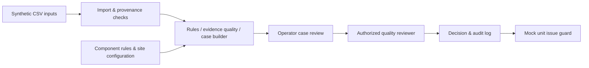

# TrustLedger — Blood cold-chain exception-to-unit review

**Terumo BCT Africa Hackathon 2026 · Team TrustLedger · Challenge areas: Cold chain + Data quality**

> **Status: design agreed provisionally; application implementation, measurements, deployment, and usability validation are still in progress.** This is a hackathon prototype using synthetic data, NOT a clinically validated blood-bank system. Do not use it for real transfusion decisions.

## The problem
Our intended user is a blood-bank duty operator investigating a temperature excursion or a gap/implausible value in monitoring records, supported by an authorized quality reviewer. The hypothesis is that assembling reliable readings, power-outage context, possible affected inventory, and documented actions in one case can reduce missed evidence and incomplete reviews. **This precise frontline bottleneck has not yet been validated with a blood-service practitioner.**

The organizer's synthetic Kenya-inspired dataset contains 399,280 hourly facility-level temperature readings, 2,609 power-outage records, 49,426 units, and 35,181 transfers. It contains deliberately missing/implausible records. These are SIMULATED issues, not statistics about any real facility.

## What we built
- **Works now:** Repository and scope documentation only; implementation not yet claimed.
- **Planned single workflow:** detect monitoring exception → classify evidence quality → open case with readings/outages → identify *verified* vs *possible/unknown* unit links → staff proposes action → authorized reviewer Accepts / Changes / Rejects → persist audit and show simulated issue-block for an authorized hold.
- **Not yet implemented or validated:** See [Product specification](docs/PRODUCT_SCOPE.md) and [Acceptance and evaluation plan](docs/TEST_PLAN.md). No measured safety or time benefit is claimed.

Demo video (3 minutes or less): **Not yet recorded**
Live demo: **Not yet available** · Test login: **Not yet configured**

## How to run it
**Not yet available.** Commands, prerequisites, sample data loading, and demo credentials will be added only after a working build is verified. Judges should not be told that a placeholder is executable.

## Architecture
**Proposed only; to be updated to match verified code.**

Input tables initially targeted: `temperature_logs`, `power_outages`, `facilities`, `units`; `transfers` is a supporting source, not a second workflow. The component/fridge/location mapping supplied by the original dataset is incomplete. Additional *clearly marked synthetic equipment-to-unit assignment fixtures* may be used solely to demonstrate a precise unit-level case, never silently portrayed as organizer data. Integration with a broader blood service or standards such as ISBT 128 / HL7 FHIR is future work, not current compliance.

## AI and data
- **Planned data feature:** evidence-quality-aware incident review (observed out-of-range reading vs missing/invalid reading; provenance; uncertainty; potential unit impact). Rules can do the critical safety work without an LLM.
- **Baseline 1:** simple valid-temperature threshold alert.
- **Baseline 2 (adversarial check):** competent rules-based monitor that also checks data gaps and implausible values.
- **Result:** **Not measured yet.** We will publish the actual baseline and prototype numbers, test cases, time window, and metric; never invent a gain.
- **Reasons:** show contributing data, timestamps, quality flag, source and gaps; never call a guess a fact.
- **Human control:** operator prepares; authorized reviewer Accepts / Changes / Rejects. AI cannot release blood, override quarantine, or determine compatibility.
- **AI-off / offline fallback:** planned local rule-based and manual case pathway; will be marked as working only when tested.

## Data
Organizer-provided synthetic starter dataset (Kenya-inspired, 2025-11-01 to 2026-10-31 EAT). `temperature_logs` is **facility-level**, not named-fridge telemetry; `units.temp_excursion_exposed` and final `units.status` are **retrospective labels**, not real-time inputs for predicting a decision. We must not leak them into a prospective model. Missing values mean **unknown**, not safe. Component storage conditions differ: do not blindly apply RBC/whole-blood thresholds to platelets or frozen products.

Supplementary evidence: [WHO 2025 Good Practices for Blood Establishments](https://www.who.int/publications/m/item/trs-1060---annex-4--good-practices-for-blood-establishments), WHO Digital Implementation Investment Guide (2020), and UNICEF Designing Digital Interventions for Lasting Impact. Published guidance informs prototype design but does not constitute site-specific clinical approval. No real donor, patient, or facility data will be used.

## African conditions
Target simple phone use, intermittent connectivity, unstable power, configurable site rules, and human-readable evidence. Each must be proven in a working test before it is described as implemented. Offline synchronization and second-country configuration are **planned tests, not verified features**.

## AI tools we used
- ChatGPT: research review, provisional workflow design, repository documentation, risk and test planning.
- Claude / Claude Code: **planned for implementation**; update to actual usage after work occurs.
- Each team member must be able to explain and test any generated code. No pre-window application code may be reused.

## Team
| Name | Role | Country | Presenting Friday (in person / online) |
|---|---|---|---|
| **To confirm against official team roster** | **To confirm** | **To confirm** | **To confirm** |

## Known limits and next steps
1. Validate the actual blood-bank SOP, reviewer authority and user bottleneck at the optional blood-service Q&A; do not substitute our assumptions for clinical procedure.
2. Lock the exact case-and-decision acceptance criteria, then build one thin end-to-end path.
3. Demonstrate unambiguous difference between confirmed affected units and candidate inventory; disclose any added synthetic unit/fridge mapping.
4. Measure the data feature against both simple and competent rule baselines, with clear test sets and no label leakage.
5. Test two roles, audit, a mock hold that blocks mock issue, and AI-off/offline fallback.
6. Provide reproducible run steps, verified screenshots/diagram, a <=3 minute video, and at most eight submission slides.

## Hackathon compliance
Code written only within 10 Nov 2026 12:00 EAT to 11 Nov 2026 12:00 EAT. Commit incrementally. Only rostered members build. One team repo; make public by submission deadline. Open-source dependencies allowed; no pre-existing application code copied from earlier projects. Disclose synthetic data additions and AI tools honestly.
