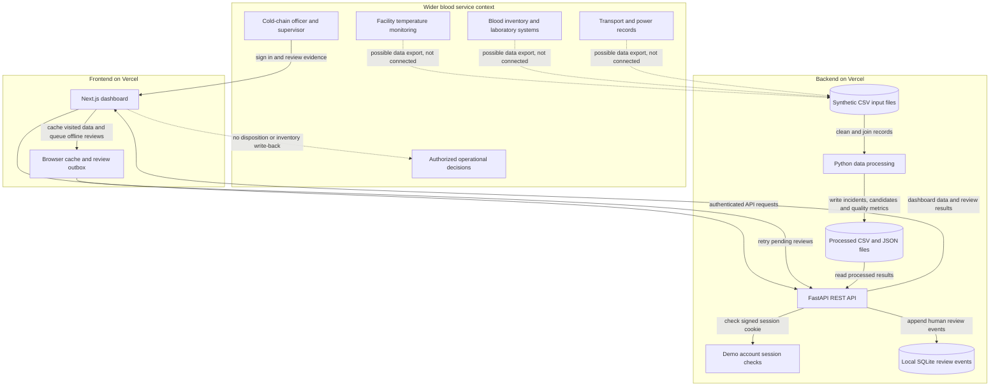
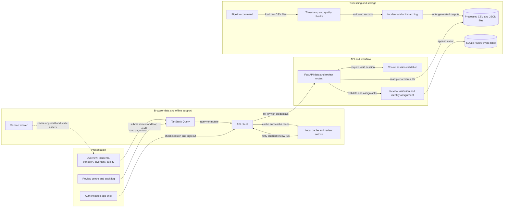

# Architecture Diagram

TrustLedger is a cold-chain incident investigation prototype. It processes a supplied synthetic dataset and presents evidence to blood-bank staff; it is not connected to live facility equipment or operational blood-service systems.

## Application Architecture

The diagram distinguishes the prototype's implemented data flow from the wider blood-service context. Dashed arrows show illustrative integration opportunities only.

<!-- mermaid-checked: no \n, no em-dash/en-dash, no {} in labels, subgraphs are id["label"], arrows are -->|"label"|, all subgraphs closed by end, ids unique -->

Solid arrows are implemented in the prototype. Dashed arrows are illustrative only: live sensor, inventory, laboratory, transport, and power-system integrations have not been implemented. TrustLedger returns investigation evidence to staff but does not write a release, quarantine, discard, compatibility, or transfusion decision to operational systems.

### Technology Stack Summary

| Layer | Technology | Version | Purpose |
|---|---|---|---|
| Browser UI | Next.js and React | 16.4.6 and 19.3.0 | Dashboard routes and responsive interface |
| Browser language | TypeScript | 5.x | Typed frontend implementation |
| Browser styling | Tailwind CSS | 4.3.3 | Layout and visual styling |
| Browser data fetching | TanStack Query | 5.107.1 | API queries, mutations, and cache invalidation |
| Browser charts and icons | Recharts and Lucide React | 3.10.1 and 1.71.0 | Temperature, incident, and quality visuals |
| API | FastAPI and Uvicorn | 0.115.12 and 0.34.0 | Authenticated REST endpoints and ASGI serving |
| API language and validation | Python and Pydantic | 3.10+ and 2.10.6 | Pipeline and request validation |
| Data processing | pandas and NumPy | 2.2.3 and 2.2.3 | CSV processing, quality checks, matching, and metrics |
| Hosting | Vercel | Managed service | Separate frontend and Python API deployments |

### Data Storage & External Services

Raw synthetic CSV inputs and generated CSV/JSON outputs are packaged with the backend deployment and read by the API. Review events are stored in a local SQLite database; this is prototype storage, not a durable shared audit service. The browser uses local storage for cached API responses and pending offline reviews, and a service worker caches visited app pages and static assets. No live external blood-bank API, message broker, cloud database, or standards adapter is currently connected.

### Key Architectural Decisions

- A build-time Python pipeline validates records and creates reusable outputs; request handlers serve these outputs instead of recalculating the entire dataset for each page request.
- Human review is a separate, authenticated workflow. Server-assigned demo identity and append-only application database triggers record who reviewed an investigation flag, while leaving operational disposition to authorized staff.
- Offline behavior is browser-scoped: cached data can be stale and queued reviews are not server audit events until they successfully sync.

## Component Relationships

This view shows how the user-facing pages call the API, how the API uses pipeline outputs and audit storage, and where authentication and browser offline behavior apply.

<!-- mermaid-checked: no \n, no em-dash/en-dash, no {} in labels, subgraphs are id["label"], arrows are -->|"label"|, all subgraphs closed by end, ids unique -->

### Component Inventory

| Component | Layer | Type | Responsibility |
|---|---|---|---|
| Overview, incidents, transport, inventory, quality | Presentation | Next.js pages | Display processed metrics, evidence, candidates, and data-quality counts |
| Review centre and audit log | Presentation | Next.js pages | Collect human investigation reviews and display recorded or pending events |
| Authenticated app shell | Presentation | React component | Check session, protect the visible app experience, provide navigation, and sign out |
| API client | Browser data | TypeScript service | Send credentialed API calls, parse errors, and route eligible reads through browser caching |
| TanStack Query | Browser data | Client state and query cache | Load API data, coordinate mutations, and refresh affected views |
| Local cache and review outbox | Browser data | Browser local storage | Retain selected reads and hold unsynced reviews for the same demo account |
| Service worker | Browser data | Web platform worker | Cache visited app pages and static assets for limited offline use |
| FastAPI data and review routes | API | REST route handlers | Return processed evidence and expose authenticated review and audit operations |
| Cookie session validation | API | Authentication dependency | Verify signed demo sessions before protected API operations |
| Review validation and identity assignment | API | Request validation and workflow logic | Validate decisions and reasons, assign actor and role from the session, and append review events |
| Pipeline command | Processing | Python CLI | Load the supplied dataset and run reproducible processing before deployment |
| Timestamp and quality checks | Processing | Data processing functions | Normalize timestamps and measure invalid values, glitches, duplicates, and missing-hour estimates |
| Incident and unit matching | Processing | Data processing functions | Group temperature episodes, reconstruct known holding intervals, and match investigation candidates |
| Processed CSV and JSON files | Storage | Deployment files | Hold generated dashboard, incident, inventory, quality, and transport results for API reads |
| SQLite review event table | Storage | Local database | Store prototype review events with application-level update and delete protections |
