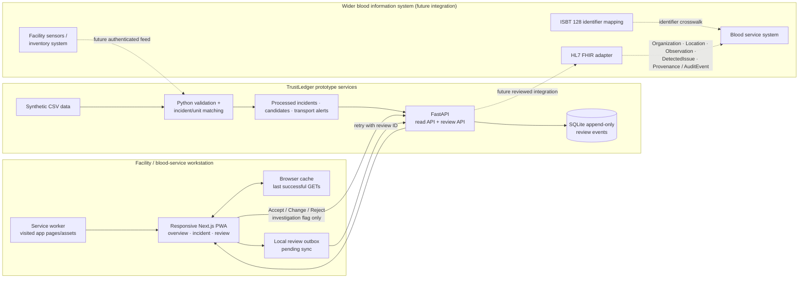

# TrustLedger architecture

## Component and data-flow diagram

Solid arrows are implemented in the prototype. Dashed arrows are conceptual future integration points, not deployed adapters. The dashboard does not connect to a real inventory, quarantine, laboratory or patient-care system.

## Implemented flow

1. Synthetic CSV files are loaded by the Python pipeline.
2. Timestamp parsing repairs the missing separator form `YYYY-MM-DDHH:MM:SS`. Missing values, sentinels, duplicate timestamps, hourly gaps and out-of-range readings are measured.
3. Consecutive out-of-range records are grouped. A sustained high-temperature episode requires four consecutive hourly readings above the configured upper bound. This threshold is an explicit prototype rule.
4. Confirmed unit holding intervals are reconstructed from available processing and transfer data. A dispatched unit with no confirmed receipt becomes location-unknown after dispatch.
5. RBC/WB units overlapping sustained incidents are returned as investigation candidates. A second, broader single-reading baseline list is generated for fallback use. Evaluation-only exposure labels are used only to calculate aggregate comparison metrics; labels are omitted from both API candidate views.
6. FastAPI exposes processed metrics and lists. Human review submissions are validated and appended to a local SQLite event table. Database triggers prevent row updates and deletes; a unique review ID makes retries idempotent.
7. RBC/WB transfers whose recorded cool-box maximum exceeds the configured upper limit are exported as a separate transport-temperature evidence list; these records are not joined to or described as facility sensor incidents.
8. The browser caches successful GET responses and stores review actions locally if a network request fails. It shows a stale/offline/pending status and retries pending events when connectivity returns.

## Human review and authorization boundary

Accept, Change and Reject apply to the **investigation flag**, not the blood unit's clinical or operational disposition. A reason is mandatory; Change also requires a revised assessment. Neither API nor UI can release, clear, discard, declare compatible, or order transfusion of a unit.

The prototype has two environment-provisioned demo accounts. The API verifies usernames/passwords, issues an eight-hour signed HttpOnly cookie, assigns the role and actor name server-side, and requires the session for API data, review creation and audit-log reads. Review payloads cannot choose an actor or role. Both roles currently have the same review permissions because the organizer role matrix has not yet been confirmed. This is not a managed identity system: there is no MFA, account recovery/lifecycle or production-grade abuse protection. Production requires identity federation, blood-service-approved server-side permissions, protected storage, audit retention and authorized integration. Local SQLite triggers are append-only at the application database layer, not tamper-proof against an administrator with file access.

## Offline and low-connectivity behavior

- The service worker caches the app shell and static assets; GET responses are cached in browser storage after a successful API response.
- When a request fails, a cached response may be shown with a visible stale-data banner. A never-cached view remains unavailable and the UI reports the error.
- Inventory can switch from sustained-event candidates to the persisted single-reading baseline list when the primary rule is uncertain or unavailable.
- Review actions can be queued in browser local storage with an explicit pending-sync marker. The API deduplicates retries using the review ID; a pending event is only sent when the same demo account is signed in, and pending entries from another account are not shown in the current account's audit view.
- This is a single-browser fallback, not multi-device synchronization or an offline-first shared database. It cannot provide fresh data without connectivity and does not send SMS.
- The responsive dashboard uses paginated API queries and is usable on small screens. Country/site branding and threshold values are settings, not source edits, but rule changes must be approved and the pipeline rerun.

## Data model

| Entity | Prototype fields | Key constraints |
|---|---|---|
| Facility | `facility_id` | Source dataset identifier; no device hierarchy supplied |
| Temperature observation | `facility_id`, `recorded_at`, `temp_c`, quality status | Hourly; sentinels excluded from excursion logic |
| Transport temperature evidence | transfer, unit, route, `coolbox_max_temp_c` | One maximum per transfer; not a continuous temperature history |
| Incident | `incident_id`, facility, start/end, severity, rule | Approximate window; rule reason shown |
| Unit candidate | unit, component, blood group, facility and overlap window | RBC/WB only; investigation candidate, not product disposition |
| Review event | review ID, incident ID, actor/role, decision, reason, changed assessment, timestamp | Append-only table; demo identity only |

## Standards mapping (conceptual)

| TrustLedger concept | Candidate standard mapping | Current state |
|---|---|---|
| Facility | HL7 FHIR `Organization` / `Location` | CSV facility key only |
| Temperature reading | FHIR `Observation` with effective time, quantity and device reference | CSV row; device ID is not available |
| Temperature incident | FHIR `DetectedIssue` or workflow `Task` | Local incident record |
| Unit inventory and transfer | FHIR `InventoryItem` / `SupplyDelivery`; ISBT 128 Donation Identification Number and Product Code crosswalk | Synthetic unit ID and transfer rows; not ISBT 128 |
| Human review and provenance | FHIR `Provenance` / `AuditEvent` | Local SQLite event fields; no FHIR adapter |

The table describes a future mapping, not standards conformance. A blood-service integration partner must confirm profiles, terminology, identifiers and workflow before implementation.

## Configuration and known limits

The API reads `TRUSTLEDGER_SITE_NAME`, `TRUSTLEDGER_COUNTRY`, `TRUSTLEDGER_TEMP_MIN_C`, `TRUSTLEDGER_TEMP_MAX_C`, and `TRUSTLEDGER_CORS_ORIGINS`; `TRUSTLEDGER_AUDIT_DB_PATH` can select the local audit database location. The frontend reads `NEXT_PUBLIC_APP_NAME`, `NEXT_PUBLIC_COUNTRY_LABEL`, and `NEXT_PUBLIC_API_BASE_URL`. Current processing uses a single RBC/WB temperature range; it is not a complete country policy engine. Threshold changes require blood-service validation, consistent environment settings, and reprocessing the dataset.

The input has no fridge or sensor identifier, timestamps are hourly, some transfer receipts are missing, and all supplied data is synthetic. Transport alerts use only a recorded maximum for RBC/WB and do not establish temperature duration or product safety. The benchmark is retrospective on labels from the same dataset, not a held-out test. Do not extrapolate its precision or recall to another facility, country or real clinical setting.
