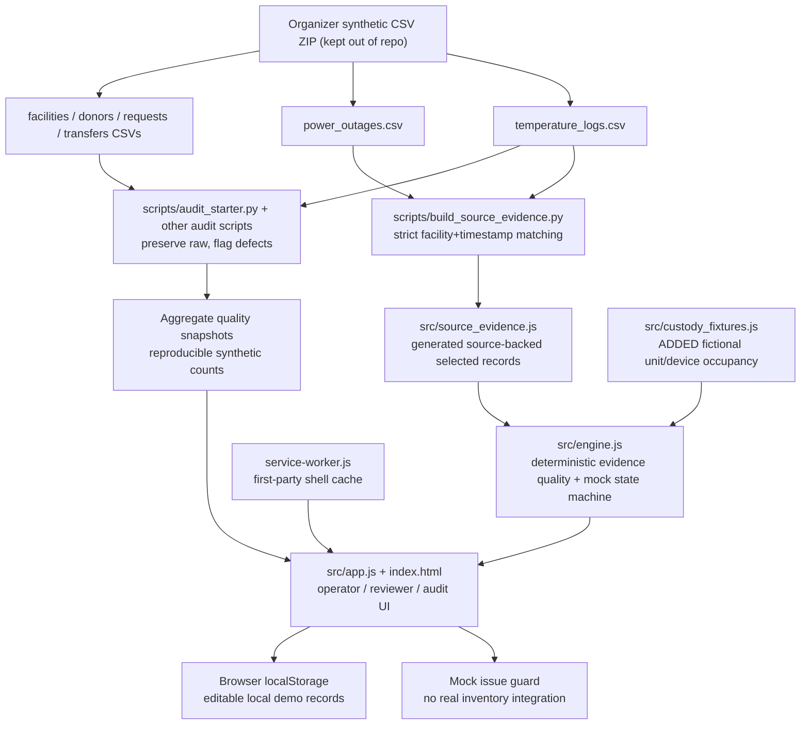
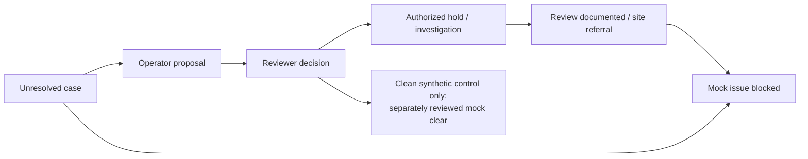

# TrustLedger — implemented architecture and failure boundaries

**Status:** architecture of the actual hackathon prototype, not a future clinical architecture.

## System/data-flow diagram



**Important runtime distinction:** `scripts/audit_starter.py` generates CSVs/JSON *offline* for reproducible analysis; the existing interactive review UI reads a **small generated source excerpt**, not all 399,280 logger rows on every visit. The aggregate snapshot is represented visually in Evidence lab. Do not call this a production CSV import pipeline.

## Data and trust boundaries

| Layer | Trust boundary | Current validation | Still absent |
|---|---|---|---|
| Organizer CSV source | Synthetic facility readings; no named fridge history | Exact facility/timestamp keys; missing-row and duplicate failures in generator | External signatures, device identity, calibration provenance |
| Source-generated runtime excerpt | Selected original records and overlapping power-outage row | Explicit file provenance; source-coded times in EAT, UTC+03:00 | Live feed, larger held-out validation |
| Added fictional custody fixture | Demonstrates temporal overlaps between a mock unit and illustrative fridge | Explicit `ADDED_SYNTHETIC_CUSTODY_FIXTURE` label, timestamps, test coverage | Verification against actual unit locations and transport |
| Deterministic evidence rules | Illustrative RBC 2–6°C demo band | Range breaches, missing expected readings, 0/-99/99.9 sentinels, invalid timestamps, duplicate readings | Local SOP validation by qualified personnel; other blood component bands |
| Decision state machine | Simulated operator and reviewer | Accept/Change/Reject; minimum rationale; flagged evidence cannot become `mock_clear`; documented non-release closure | Real identity, role-based authorization, dual control, legal clinical authority |
| Mock issue desk | Tests a restriction as software behavior | Rejects unresolved/abnormal evidence; records attempts | Hospital inventory transaction lock, blood-group compatibility or actual transfusion authorization |
| Client storage / offline | Browser profile only | localStorage and first-party shell cache | Server persistence, tamper-evident immutable audit, conflict resolution, multi-device sync |

## Case examples

**TL-024 — missing logger evidence.** HSP-024 has normal-looking readings at **30 Sep 09:00 3.9°C** and **2 Oct 19:00 4.3°C**, 58 hours apart, with 57 absent expected hourly records. No reliable temperature inference during that gap. There is *no verified matching power outage record* for this excerpt; do not invent its cause.

**TL-NBO-HOT — observed excursion plus independent source context.** RBTC-NBO records **7.9°C** at 01:00 EAT on 6 Oct 2026. Independent `power_outages.csv` identifies **OUT-00009**, 5 Oct 22:18 to 6 Oct 02:08, backup not engaged, approximately 3.83 hours. These are overlapping source records, **not proof of causation or individual unit exposure**.

**TL-NBO-GLITCH — source-dictionary sensor sentinel.** An original 99.9°C raw reading is flagged as a documented synthetic sensor glitch, not interpreted as a real observed fridge excursion; raw remains visible.

**TL-024-CONTROL — bounded negative control.** Four consecutive source values are in range; the window can be mock-cleared only after simulated reviewer acceptance. This does not authorize a real clinical release.

## Deterministic audit-to-action state



A review can be *documented* or referred without making storage history safe. A reviewer cannot override missing temperature evidence into clinical clearance using a note. The demo's action labels remain **simulated**.

## Baselines, limitations and future directions

- **Latest-only simple alert:** on four deliberately chosen examples, **1/4 correct**; misses the 57-hour monitoring gap despite a normal latest reading.
- **Competent conventional gap/outlier rules:** **4/4 correct**.
- **TrustLedger evidence classifier:** **4/4 correct**, **tied**. No trained AI; feature contribution is evidence explanation, provenance and human-review workflow, whose real-world gain has not been independently measured.
- **Whole-year descriptive source scan:** 387 monitoring gaps, 381 resume with 2–6°C reading; a good conventional monitor can also find these gaps.
- **Africa fit:** phone-responsive and locally cached shell without a required external AI call. Device-specific offline operation, server sync, site/country configuration and clinical staff acceptance remain untested.
- **Deployment gates:** authenticated staff, per-site SOP, validated unit/equipment history, secure audit and clinical review, legal data processing assessment, reliability testing, and integration with real inventory systems.

## Repeatable checks

```bash
npm test
python3 -m unittest discover -s tests -p "test_*.py" -v
npx playwright test
```

Workflow run record: [Verification](https://github.com/okoyeDelight/Trustledger-bct-2026/actions/workflows/verify.yml), [Browser evaluation](https://github.com/okoyeDelight/Trustledger-bct-2026/actions/workflows/browser-evaluator.yml). Full organizer source ZIP is intentionally not bundled with the runtime.
